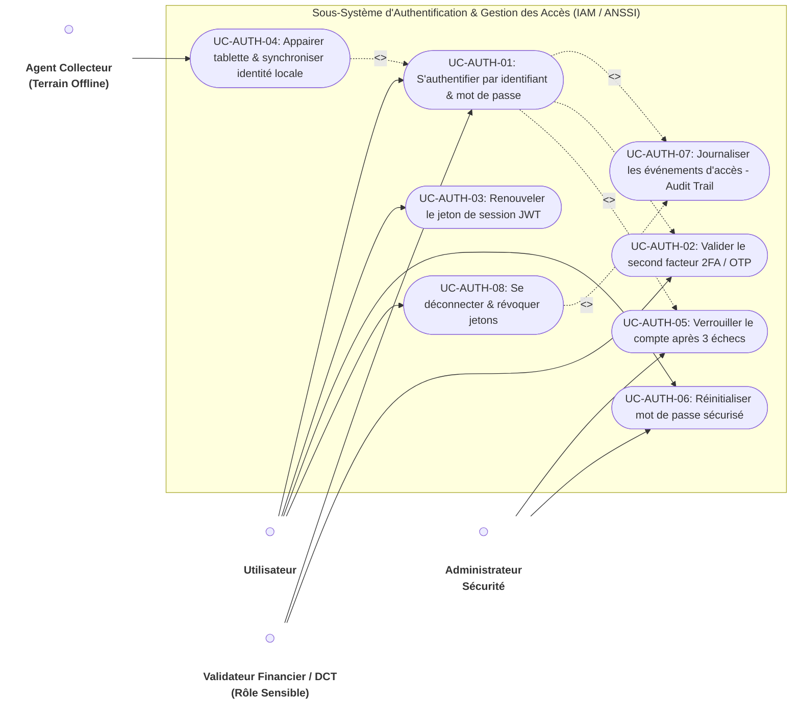
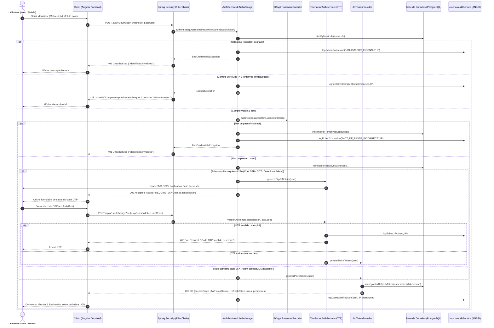
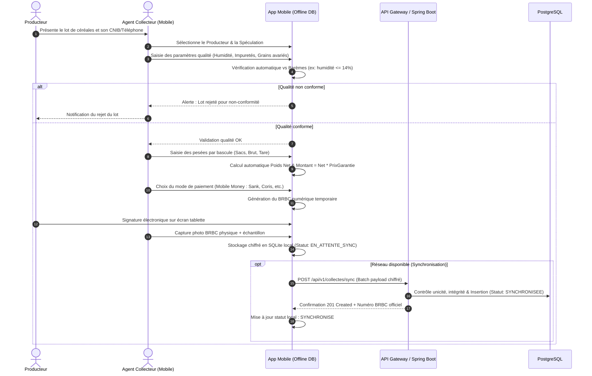
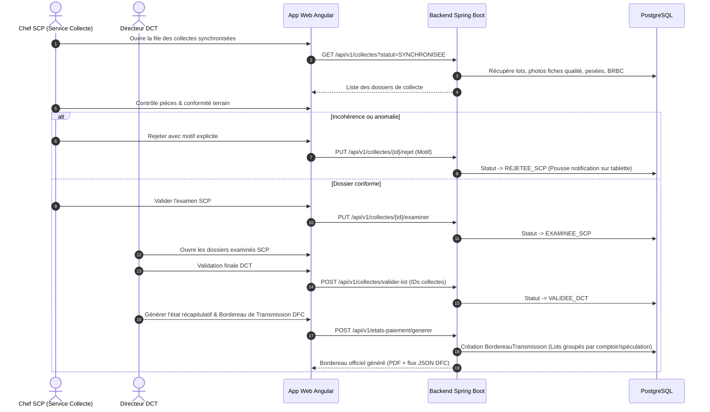
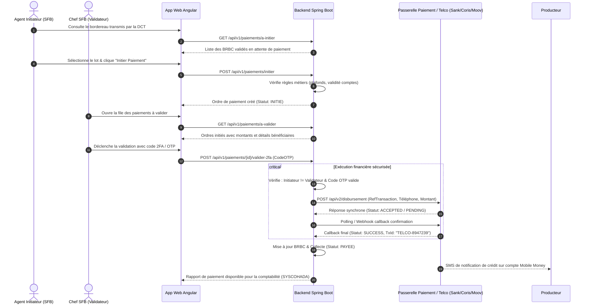
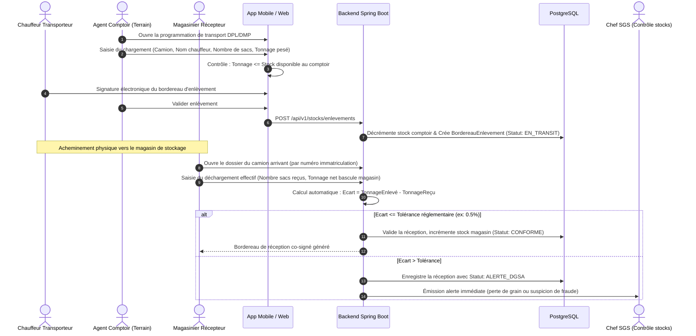

# DOSSIER DE CONCEPTION TECHNIQUE & MODÉLISATION UML
## Projet : Plateforme de Dématérialisation de la Collecte Bord Champ (CBC) - SONAGESS
**Ministère de l'Agriculture, des Ressources Animales et Halieutiques (Burkina Faso)**

---

## 1. Synthèse de la Capacité (Product Capability)

* **Objectif global** : Dématérialiser intégralement la chaîne de collecte bord champ des céréales et légumineuses (riz paddy, maïs, niébé, etc.), depuis le contrôle qualité et la pesée sur le terrain jusqu'au paiement électronique des producteurs et à l'entrée des stocks en magasins centraux.
* **Gains opérationnels visés** : Réduction du délai de paiement des producteurs de 21 jours à **7 jours ouvrables** ; réduction du délai de transfert en magasins de 15 jours à **9 jours** ; traçabilité totale et visibilité journalière des stocks et paiements.
* **Architecture cible** :
  * **Application Web** : Angular 18+, destinée aux directions centrales (DCT, DFC, DGSA, DPL, Comptabilité) et administrateurs.
  * **Back-end central** : Spring Boot 3.x (Java 21) avec API REST sécurisée (OAuth2 / JWT + RBAC) et base PostgreSQL.
  * **Application Mobile terrain** : Android (tablettes SONAGESS), opérant en mode **déconnecté (offline-first)** avec synchronisation chiffrée.

---

## 2. Diagrammes de Cas d'Utilisation (Use Cases)

### 2.1. Vue d'ensemble des acteurs
* **Acteurs Métier Terrain** : Agent Collecteur, Chef de Comptoir, Magasinier.
* **Acteurs Métier Siège / Directions** : Chef SCP (Service Collecte), Directeur/Agent DCT (Direction de la Collecte et de la Transformation), Agent initiateur SFB, Chef SFB (Validation financière), Service Comptabilité, SGS / DGSA (Gestion des stocks).
* **Acteurs Externes** : Producteurs, Passerelles de Notification (SMS Passerelle, FCM Push, Serveur SMTP), Opérateurs Mobile Money (Sank Money, Coris Money, Moov Money, LigdiCash), Transporteurs.

### 2.2. Diagramme Global des Cas d'Utilisation (UML Use Case)

```mermaid
flowchart LR
    %% ACTEURS TERRAIN (Bonshommes UML)
    AgentCollecteur["<svg width='28' height='46' viewBox='0 0 28 46' xmlns='http://www.w3.org/2000/svg'><circle cx='14' cy='8' r='6' stroke='%230284c7' stroke-width='2' fill='%23e0f2fe'/><line x1='14' y1='14' x2='14' y2='30' stroke='%230284c7' stroke-width='2'/><line x1='3' y1='20' x2='25' y2='20' stroke='%230284c7' stroke-width='2'/><line x1='14' y1='30' x2='5' y2='44' stroke='%230284c7' stroke-width='2'/><line x1='14' y1='30' x2='23' y2='44' stroke='%230284c7' stroke-width='2'/></svg><br/><b>Agent Collecteur</b>"]
    ChefComptoir["<svg width='28' height='46' viewBox='0 0 28 46' xmlns='http://www.w3.org/2000/svg'><circle cx='14' cy='8' r='6' stroke='%230284c7' stroke-width='2' fill='%23e0f2fe'/><line x1='14' y1='14' x2='14' y2='30' stroke='%230284c7' stroke-width='2'/><line x1='3' y1='20' x2='25' y2='20' stroke='%230284c7' stroke-width='2'/><line x1='14' y1='30' x2='5' y2='44' stroke='%230284c7' stroke-width='2'/><line x1='14' y1='30' x2='23' y2='44' stroke='%230284c7' stroke-width='2'/></svg><br/><b>Chef de Comptoir</b>"]
    Magasinier["<svg width='28' height='46' viewBox='0 0 28 46' xmlns='http://www.w3.org/2000/svg'><circle cx='14' cy='8' r='6' stroke='%230284c7' stroke-width='2' fill='%23e0f2fe'/><line x1='14' y1='14' x2='14' y2='30' stroke='%230284c7' stroke-width='2'/><line x1='3' y1='20' x2='25' y2='20' stroke='%230284c7' stroke-width='2'/><line x1='14' y1='30' x2='5' y2='44' stroke='%230284c7' stroke-width='2'/><line x1='14' y1='30' x2='23' y2='44' stroke='%230284c7' stroke-width='2'/></svg><br/><b>Magasinier Récepteur</b>"]

    %% ACTEURS SIEGE / DIRECTIONS (Bonshommes UML)
    ChefSCP["<svg width='28' height='46' viewBox='0 0 28 46' xmlns='http://www.w3.org/2000/svg'><circle cx='14' cy='8' r='6' stroke='%230284c7' stroke-width='2' fill='%23e0f2fe'/><line x1='14' y1='14' x2='14' y2='30' stroke='%230284c7' stroke-width='2'/><line x1='3' y1='20' x2='25' y2='20' stroke='%230284c7' stroke-width='2'/><line x1='14' y1='30' x2='5' y2='44' stroke='%230284c7' stroke-width='2'/><line x1='14' y1='30' x2='23' y2='44' stroke='%230284c7' stroke-width='2'/></svg><br/><b>Chef Service Collecte (SCP)</b>"]
    DCT["<svg width='28' height='46' viewBox='0 0 28 46' xmlns='http://www.w3.org/2000/svg'><circle cx='14' cy='8' r='6' stroke='%230284c7' stroke-width='2' fill='%23e0f2fe'/><line x1='14' y1='14' x2='14' y2='30' stroke='%230284c7' stroke-width='2'/><line x1='3' y1='20' x2='25' y2='20' stroke='%230284c7' stroke-width='2'/><line x1='14' y1='30' x2='5' y2='44' stroke='%230284c7' stroke-width='2'/><line x1='14' y1='30' x2='23' y2='44' stroke='%230284c7' stroke-width='2'/></svg><br/><b>Dir. Collecte &amp; Transformation (DCT)</b>"]
    SFB_Initiateur["<svg width='28' height='46' viewBox='0 0 28 46' xmlns='http://www.w3.org/2000/svg'><circle cx='14' cy='8' r='6' stroke='%230284c7' stroke-width='2' fill='%23e0f2fe'/><line x1='14' y1='14' x2='14' y2='30' stroke='%230284c7' stroke-width='2'/><line x1='3' y1='20' x2='25' y2='20' stroke='%230284c7' stroke-width='2'/><line x1='14' y1='30' x2='5' y2='44' stroke='%230284c7' stroke-width='2'/><line x1='14' y1='30' x2='23' y2='44' stroke='%230284c7' stroke-width='2'/></svg><br/><b>Agent Initiateur SFB</b>"]
    SFB_Chef["<svg width='28' height='46' viewBox='0 0 28 46' xmlns='http://www.w3.org/2000/svg'><circle cx='14' cy='8' r='6' stroke='%23d97706' stroke-width='2' fill='%23fef3c7'/><line x1='14' y1='14' x2='14' y2='30' stroke='%23d97706' stroke-width='2'/><line x1='3' y1='20' x2='25' y2='20' stroke='%23d97706' stroke-width='2'/><line x1='14' y1='30' x2='5' y2='44' stroke='%23d97706' stroke-width='2'/><line x1='14' y1='30' x2='23' y2='44' stroke='%23d97706' stroke-width='2'/></svg><br/><b>Chef SFB (Validateur 2FA)</b>"]
    Comptable["<svg width='28' height='46' viewBox='0 0 28 46' xmlns='http://www.w3.org/2000/svg'><circle cx='14' cy='8' r='6' stroke='%230284c7' stroke-width='2' fill='%23e0f2fe'/><line x1='14' y1='14' x2='14' y2='30' stroke='%230284c7' stroke-width='2'/><line x1='3' y1='20' x2='25' y2='20' stroke='%230284c7' stroke-width='2'/><line x1='14' y1='30' x2='5' y2='44' stroke='%230284c7' stroke-width='2'/><line x1='14' y1='30' x2='23' y2='44' stroke='%230284c7' stroke-width='2'/></svg><br/><b>Service Comptabilité</b>"]
    SGS["<svg width='28' height='46' viewBox='0 0 28 46' xmlns='http://www.w3.org/2000/svg'><circle cx='14' cy='8' r='6' stroke='%230284c7' stroke-width='2' fill='%23e0f2fe'/><line x1='14' y1='14' x2='14' y2='30' stroke='%230284c7' stroke-width='2'/><line x1='3' y1='20' x2='25' y2='20' stroke='%230284c7' stroke-width='2'/><line x1='14' y1='30' x2='5' y2='44' stroke='%230284c7' stroke-width='2'/><line x1='14' y1='30' x2='23' y2='44' stroke='%230284c7' stroke-width='2'/></svg><br/><b>Service Gestion Stocks (SGS)</b>"]
    Admin["<svg width='28' height='46' viewBox='0 0 28 46' xmlns='http://www.w3.org/2000/svg'><circle cx='14' cy='8' r='6' stroke='%23ef4444' stroke-width='2' fill='%23fee2e2'/><line x1='14' y1='14' x2='14' y2='30' stroke='%23ef4444' stroke-width='2'/><line x1='3' y1='20' x2='25' y2='20' stroke='%23ef4444' stroke-width='2'/><line x1='14' y1='30' x2='5' y2='44' stroke='%23ef4444' stroke-width='2'/><line x1='14' y1='30' x2='23' y2='44' stroke='%23ef4444' stroke-width='2'/></svg><br/><b>Administrateur Système</b>"]

    %% ACTEURS EXTERNES (Bonshommes UML)
    Producteur["<svg width='28' height='46' viewBox='0 0 28 46' xmlns='http://www.w3.org/2000/svg'><circle cx='14' cy='8' r='6' stroke='%2316a34a' stroke-width='2' fill='%23dcfce7'/><line x1='14' y1='14' x2='14' y2='30' stroke='%2316a34a' stroke-width='2'/><line x1='3' y1='20' x2='25' y2='20' stroke='%2316a34a' stroke-width='2'/><line x1='14' y1='30' x2='5' y2='44' stroke='%2316a34a' stroke-width='2'/><line x1='14' y1='30' x2='23' y2='44' stroke='%2316a34a' stroke-width='2'/></svg><br/><b>Producteur</b>"]
    PasserelleNotif["<svg width='28' height='46' viewBox='0 0 28 46' xmlns='http://www.w3.org/2000/svg'><circle cx='14' cy='8' r='6' stroke='%239333ea' stroke-width='2' fill='%23f3e8ff'/><line x1='14' y1='14' x2='14' y2='30' stroke='%239333ea' stroke-width='2'/><line x1='3' y1='20' x2='25' y2='20' stroke='%239333ea' stroke-width='2'/><line x1='14' y1='30' x2='5' y2='44' stroke='%239333ea' stroke-width='2'/><line x1='14' y1='30' x2='23' y2='44' stroke='%239333ea' stroke-width='2'/></svg><br/><b>Passerelle Notifications<br/>(SMS / Push / SMTP)</b>"]

    subgraph Systeme["Plateforme Collecte Bord Champ (SONAGESS)"]
        %% Module Parametrage
        UC01([UC01: Gérer campagnes & objectifs])
        UC02([UC02: Gérer prix garantis, seuils & barèmes])
        UC03([UC03: Gérer paramétrage & comptes])
        UC04([UC04: Affecter tablettes & ouvrir comptoir])

        %% Module Collecte
        UC06([UC06: Enregistrer collecte bord champ])
        UC05([UC05: Tenir fiche journalière stocks & emballages])
        UC07([UC07: Examiner SCP & Valider DCT les BRBC])

        %% Module Paiement
        UC08([UC08: Établir états récapitulatifs paiement])
        UC09([UC09: Contrôler & Trier pièces DFC])
        UC10([UC10: Initier & Valider ordre paiement Mobile Money 2FA])
        UC11([UC11: Payer en espèces & décaisser])
        UC12([UC12: Rapprochement bancaire & relevés])
        UC15([UC15: Générer écritures SYSCOHADA & exporter])

        %% Module Transfert & Magasins
        UC16([UC16: Programmer transferts & transport])
        UC17([UC17: Établir bordereau d'enlèvement comptoir])
        UC18([UC18: Réceptionner en magasin & constater écarts])

        %% Module Notifications & Alertes
        UC21([UC21: Notifier par SMS confirmation BRBC & paiement])
        UC22([UC22: Pousser alertes rejet lot, seuil stock & transfert])
        UC23([UC23: Consulter centre notifications & relancer])

        %% Module Reporting
        UC20([UC20: Consulter tableaux de bord temps réel])
    end

    %% Relations Paramétrage
    Admin --> UC03
    DCT --> UC01
    DCT --> UC02
    ChefComptoir --> UC04

    %% Relations Collecte
    AgentCollecteur --> UC06
    ChefComptoir --> UC05
    ChefSCP --> UC07
    DCT --> UC07

    %% Relations Paiement
    DCT --> UC08
    SFB_Initiateur --> UC09
    SFB_Initiateur --> UC10
    SFB_Chef --> UC10
    Comptable --> UC12
    Comptable --> UC15

    %% Relations Transfert
    DCT --> UC16
    SGS --> UC16
    AgentCollecteur --> UC17
    Magasinier --> UC18
    SGS --> UC18

    %% Relations Notifications & Alertes
    PasserelleNotif --> UC21
    PasserelleNotif --> UC22
    UC21 --> Producteur
    UC22 --> AgentCollecteur
    DCT --> UC23
    Admin --> UC23

    %% Relations Reporting
    DCT --> UC20
    SGS --> UC20
    Admin --> UC20

    classDef actorStyle fill:transparent,stroke:none;
    class AgentCollecteur,ChefComptoir,Magasinier,ChefSCP,DCT,SFB_Initiateur,SFB_Chef,Comptable,SGS,Admin,Producteur,PasserelleNotif actorStyle;
```



### 2.3. Diagramme de Cas d'Utilisation : Authentification & Sécurité (IAM / ANSSI)



---

## 3. Modèle de Données & Diagramme de Classes (JPA / Relationnel)

Le diagramme de classes modélise l'architecture de données requise pour l'ORM Spring Data JPA et la base PostgreSQL.

```mermaid
classDiagram
    %% MODULE SECURITE & AUTHENTIFICATION (RBAC & 2FA)
    class Utilisateur {
        +Long id
        +String matricule
        +String nom
        +String prenom
        +String email
        +String telephone
        +String motDePasseHash
        +Boolean actif
        +Boolean compteBloque
        +Integer tentativesEchouees
        +LocalDateTime dateDerniereConnexion
    }

    class Role {
        +Long id
        +String code
        +String libelle
        +String description
    }

    class Permission {
        +Long id
        +String code
        +String libelle
        +String module
    }

    class PerimetreIntervention {
        +Long id
        +String typePerimetre
        +Long entiteId
        +String libelleZone
    }

    class TwoFactorAuth {
        +Long id
        +Boolean active
        +String secretKeyTotp
        +String dernierCodeOtp
        +LocalDateTime dateExpirationOtp
        +String type2FA
    }

    class RefreshToken {
        +Long id
        +String tokenHash
        +LocalDateTime dateExpiration
        +Boolean revoque
        +String adresseIpCreation
    }

    class TabletteDevice {
        +Long id
        +String numeroSerie
        +String imei
        +String modele
        +String cleChiffrementLocale
        +String statut
        +LocalDateTime dateDerniereSynchro
    }

    class JournalAudit {
        +Long id
        +String action
        +String entiteConcernee
        +Long entiteId
        +LocalDateTime dateAction
        +String adresseIp
        +String userAgent
        +String resultat
    }

    %% MODULE DECOUPAGE ADMINISTRATIF OFFICIEL (Conforme DGTD/DCSI & Décrets Juillet 2025)
    class Locality {
        +UUID id
        +String code
        +String name
        +LocalityType type
        +UUID parentId
        +Double latitude
        +Double longitude
        +Status status
        +Boolean isDeleted
    }

    class LocalityHierarchy {
        +UUID ancestorId
        +UUID descendantId
        +Integer depth
    }

    class LocalityType {
        <<enumeration>>
        COUNTRY
        REGION
        PROVINCE
        COMMUNE
        ARRONDISSEMENT
        SECTOR
        VILLAGE
    }

    %% MODULE PARAMETRAGE & CAMPAGNE
    class Campagne {
        +Long id
        +String code
        +String libelle
        +LocalDate dateDebut
        +LocalDate dateFin
        +Double objectifTotalTonnes
    }

    class ObjectifCampagne {
        +Long id
        +Double objectifTonnes
        +Double budgetPrevisionnelCFA
        +Double seuilAlertePct
    }

    class Speculation {
        +Long id
        +String code
        +String nom
        +Double seuilHumiditeMax
        +Double seuilImpureteMax
        +Boolean active
    }

    class PrixGarantie {
        +Long id
        +Double prixUnitaireKg
        +LocalDate dateEffet
    }

    class Comptoir {
        +Long id
        +String code
        +String nom
        +String type
        +Double latitudeGps
        +Double longitudeGps
        +Double capaciteStockageKg
    }

    %% PRODUCTEUR (Conforme Outil BRBC/FP : CNIB délivrance & contact)
    class Producteur {
        +Long id
        +String nomPrenom
        +String telephoneMobileMoney
        +String operateurMobile
        +String cnibNumero
        +LocalDate cnibDateDelivrance
        +String cnibLieuDelivrance
        +String adressePrecision
    }

    %% MODULE COLLECTE BORD CHAMP (Conforme Outil FP & BRBC)
    class CollecteBordChamp {
        +Long id
        +String referenceLot
        +LocalDateTime dateHeureCollecte
        +String statut
        +Double latitudeGps
        +Double longitudeGps
    }

    class ControleQualite {
        +Long id
        +Double tauxHumidite
        +Double tauxImpuretes
        +Double grainsAvaries
        +Boolean conforme
        +String decisionAgent
    }

    class FichePesee_FP {
        +Long id
        +String numeroFiche
        +String directionRegionale
        +String directionProvinciale
        +String siteComptoir
        +Integer nombreSacs
        +Double poidsBrutTotalKg
        +Double tareEmballageKg
        +Double poidsNetTotalKg
    }

    class BordereauReception_BRBC {
        +Long id
        +String numeroBRBC
        +LocalDateTime dateEmission
        +Double quantiteKg
        +Double prixUnitaireApplique
        +Double montantNetPayerCFA
        +String montantEnLettres
        +String modePaiement
        +String observationsReceptionnaire
        +String signatureProducteurToken
        +String signatureAgentToken
        +String statutValidation
    }

    %% MODULE PAIEMENT & FINANCES
    class OrdrePaiement {
        +Long id
        +String referenceTransaction
        +Double montantPayeCFA
        +String operateur
        +String telephoneDestination
        +LocalDateTime dateInitiation
        +LocalDateTime dateValidation2FA
        +String statut
    }

    %% MODULE TRANSFERT & LOGISTIQUE (Conforme Outil BEBC)
    class BordereauEnlevement_BEBC {
        +Long id
        +String numeroBEBC
        +String direction
        +String localite
        +String magasinDepart
        +String beneficiaire
        +String objetEnlevement
        +String colisage
        +Integer nombreSacs
        +Double tonnageEnleveKg
        +NomTransporteur nomTransporteur
        +String numeroVehicule
        +String signatureTransporteurToken
        +String statut
    }

    class MagasinCentral {
        +Long id
        +String codeMagasin
        +String nom
        +String ville
        +Double capaciteTotaleTonnes
        +Double stockActuelTonnes
    }

    class BordereauReceptionMagasin {
        +Long id
        +String numeroReception
        +LocalDateTime dateDechargement
        +Integer nombreSacsRecus
        +Double tonnageDechargeKg
        +Double ecartPoidsKg
        +String statutConformite
    }

    %% MODULE GESTION DES STOCKS & EMBALLAGES (Conforme Outils FSJ & Feuil2)
    class FicheStockJournaliere_FSJ {
        +Long id
        +LocalDate date
        +String natureOperation
        +Integer entreeSacs
        +Double entreePoidsKg
        +Double entreeValeurCFA
        +Integer sortieSacs
        +Double sortiePoidsKg
        +Double sortieValeurCFA
        +Integer stockFinalSacs
        +Double stockFinalPoidsKg
        +Double stockFinalValeurCFA
    }

    class FicheStockMateriel_Emballages {
        +Long id
        +String designationMateriel
        +String referenceDoc
        +Integer entreesEmballages
        +Integer sortiesEmballages
        +Integer stockEmballages
    }

    %% MODULE NOTIFICATIONS & ALERTES MULTICANALES
    class Notification {
        +Long id
        +CanalNotification canal
        +TypeNotification typeNotification
        +String destinataireContact
        +String titre
        +String message
        +StatutNotification statut
        +LocalDateTime dateCreation
        +LocalDateTime dateEnvoi
        +LocalDateTime dateLecture
        +String referenceExterneGateway
        +Integer tentativesEnvoi
        +String erreurMessage
    }

    class CanalNotification {
        <<enumeration>>
        SMS
        PUSH_MOBILE
        EMAIL
        IN_APP
    }

    class StatutNotification {
        <<enumeration>>
        EN_ATTENTE
        ENVOYE
        DISTRIBUE
        ECHEC
        LU
    }

    class TypeNotification {
        <<enumeration>>
        CONFIRMATION_BRBC
        PAIEMENT_MOBILE_RECU
        REJET_DOSSIER_COLLECTE
        ALERTE_SEUIL_STOCK
        ALERTE_ECART_TRANSFERT
        CHALLENGE_OTP_2FA
    }

    %% RELATIONS SECURITE & HABILITATIONS
    Utilisateur "1" *-- "0..1" TwoFactorAuth : possede
    Utilisateur "*" -- "*" Role : possede_role
    Role "*" -- "*" Permission : dispose_de
    Utilisateur "1" *-- "*" PerimetreIntervention : restreint_par
    Utilisateur "1" *-- "*" RefreshToken : sessions
    Utilisateur "1" -- "0..1" TabletteDevice : utilise
    Utilisateur "1" --> "*" JournalAudit : trace_par

    %% RELATIONS METIER & COLLECTE
    Campagne "1" *-- "*" ObjectifCampagne : fixe
    Speculation "1" <-- "*" ObjectifCampagne : concerne
    Locality "0..1" <-- "*" ObjectifCampagne : alloue_a_region
    Campagne "1" *-- "*" PrixGarantie : definit
    Speculation "1" *-- "*" PrixGarantie : concerne
    Campagne "1" -- "*" CollecteBordChamp : planifie
    Comptoir "1" *-- "*" CollecteBordChamp : realisee_a
    Comptoir "1" *-- "*" FicheStockJournaliere_FSJ : tenue_quotidienne
    Comptoir "1" *-- "*" FicheStockMateriel_Emballages : suivi_kits
    Producteur "1" -- "*" CollecteBordChamp : vend
    Speculation "1" -- "*" CollecteBordChamp : concerne
    Utilisateur "1" -- "*" CollecteBordChamp : saisie_par

    CollecteBordChamp "1" *-- "1" ControleQualite : certifiee_par
    CollecteBordChamp "1" *-- "1" FichePesee_FP : quantifiee_par
    CollecteBordChamp "1" *-- "1" BordereauReception_BRBC : materialisee_par
    BordereauReception_BRBC "1" *-- "0..1" OrdrePaiement : regle_par
    Utilisateur "1" -- "*" OrdrePaiement : initie_par
    Utilisateur "1" -- "*" OrdrePaiement : valide_par

    %% RELATIONS TRANSFERT VERS MAGASIN
    Comptoir "1" *-- "*" BordereauEnlevement_BEBC : depart_de
    BordereauEnlevement_BEBC "1" -- "0..1" BordereauReceptionMagasin : transfere_vers
    MagasinCentral "1" *-- "*" BordereauReceptionMagasin : recoit_dans

    %% RELATIONS DECOUPAGE ADMINISTRATIF (Closure Table & Rattachements)
    Locality "1" *-- "*" Locality : parent_de
    Locality "1" <-- "*" LocalityHierarchy : descendant
    Locality "1" <-- "*" Comptoir : situe_dans
    Locality "1" <-- "*" Producteur : reside_dans
    Locality "0..1" <-- "*" PrixGarantie : applique_a
    Locality "0..1" <-- "*" PerimetreIntervention : restreint_a

    %% RELATIONS NOTIFICATIONS & ALERTES MULTICANALES
    Utilisateur "0..1" <-- "*" Notification : destinee_a_utilisateur
    Producteur "0..1" <-- "*" Notification : destinee_a_producteur
    CollecteBordChamp "0..1" <-- "*" Notification : generee_par_collecte
    OrdrePaiement "0..1" <-- "*" Notification : generee_par_paiement
    BordereauEnlevement_BEBC "0..1" <-- "*" Notification : generee_par_transfert
```



### 3.1. Matrice de Concordance avec les Outils de Gestion Existants (Excel)

Le tableau ci-dessous formalise l'adéquation exacte (1-to-1) entre les modèles de bordereaux opérationnels actuellement exploités par la SONAGESS (`outils de gestion.xlsx`) et les entités informatisées du modèle conceptuel et du DTC :

| Feuille Excel (`outils de gestion.xlsx`) | Intitulé Métier Opérationnel | Entité Conceptuelle / Classe JPA | Cas d'Utilisation Associé | Champs & Attributs Concordants Majeurs |
|---|---|---|---|---|
| **Feuille 1 : `BRBC`** | Bordereau de Réception Bord Champ (Liasses 5 feuillets) | `BordereauReception_BRBC`, `CollecteBordChamp`, `Producteur` | **UC03** : Collecter bord champ & éditer BRBC numérique | N° BRBC, date, producteur, CNIB (N°, date et lieu de délivrance), contact, spéculation, quantité (kg), PU garanti, montant total en chiffres et lettres, observations du réceptionnaire, signature électronique. |
| **Feuille 2 : `BEBC`** | Bordereau d'Enlèvement Bord Champ (Évacuation vers magasins) | `BordereauEnlevement_BEBC`, `TransfertStock` | **UC07** : Gérer les transferts & enlèvements | N° BEBC, Direction/Province, magasin d'expédition, bénéficiaire, objet de l'enlèvement, colisage/sacs, tonnage net, transporteur, N° véhicule, visa/signature transporteur. |
| **Feuille 3 : `FP`** | Fiche de Pesée Bord Champ (Détail bascule) | `FichePesee_FP`, `LignePeseeBascule` | **UC02** : Enregistrer les pesées & calcul tare | N° fiche, site comptoir, tare sacs, poids brut cumulé, poids net déduit, contrôle tolérance bascule. |
| **Feuille 4 : `FSJ`** | Fiche de Stock Journalière Comptoir | `FicheStockJournaliere_FSJ` | **UC05** : Tenir le journal des stocks comptoir | Date, nature de l'opération, Entrées (sacs, kg, montant CFA), Sorties (sacs, kg, montant CFA), Stock restant (sacs, kg, montant CFA). |
| **Feuille 5 : `FSM`** | Fiche de Stock Mensuelle (Réconciliation périodique) | `FicheStockJournaliere_FSJ` (Agrégation SQL / Vues analytiques) | **UC06** : Clôturer & réconcilier périodiquement les stocks | Récapitulatif mensuel par spéculation, balance globale entrées/sorties, détection des freintes et pertes. |
| **Feuille 6 : `Feuil2`** | Fiche de Gestion des Emballages et Produits Phytosanitaires | `FicheStockMateriel_Emballages` | **UC05** & Module Logistique | Suivi quantitatif des stocks de sacs neufs/réutilisés, bâches, réactifs de traitement insecticide, mouvements entrées/sorties par référence. |

### 3.2. Référentiel Administratif Officiel du Burkina Faso (Modèle DGTD/DCSI & Décrets Juillet 2025)

Pour garantir une intégrité absolue et s'aligner sur les standards nationaux de l'ANPTIC/DGTD/DCSI, la plateforme adopte le **modèle unifié de gestion des localités avec table de fermeture (Closure Table Pattern)** issu du service d'infrastructure `locality-service` :

1. **Structure Institutionnelle (Décrets de Juillet 2025)** :
   * **1 Pays** : Burkina Faso (`code: BF`).
   * **17 Régions aux dénominations endogènes** : Bankui, Djôrô, Goulmou, Guiriko, Kadiogo, Kuilsé, Liptako, Nando, Nakambé, Nazinon, Oubri, Sirba, Soum, Sourou, Tannounyan, Tapoa, Yaadga.
   * **47 Provinces**, **351 Communes**, arrondissements, secteurs et villages.
2. **Entité Unifiée `Locality`** :
   * Gère de manière homogène tous les échelons territoriaux grâce à l'énumération `LocalityType` (`COUNTRY`, `REGION`, `PROVINCE`, `COMMUNE`, `ARRONDISSEMENT`, `SECTOR`, `VILLAGE`).
   * Dispose de coordonnées GPS (`latitude`, `longitude`) et d'un auto-référencement hiérarchique `parentId`.
3. **Table de Fermeture `LocalityHierarchy` (Closure Table)** :
   * Stocke l'arbre complet des relations `ancestor_id` $\rightarrow$ `descendant_id` avec la profondeur `depth`.
   * **Performance $O(1)$** : Permet de remonter ou de descendre instantanément dans l'arbre administratif sans requête SQL récursive lourde (ex: récupérer en une seule requête indexée tous les comptoirs, collectes ou producteurs d'une Région ou Province donnée).
4. **Interconnexions Métier** :
   * **`Comptoir`** $\rightarrow$ rattaché à une `Locality` (Commune, Secteur ou Village).
   * **`Producteur`** $\rightarrow$ localisé via sa `Locality` de rattachement et son adresse détaillée.
   * **`PrixGarantie`** $\rightarrow$ rattaché soit au niveau national (`code: BF`), soit à une `Locality` régionale/provinciale.
   * **`PerimetreIntervention`** $\rightarrow$ restreint le rayon d'action d'un agent/responsable à un sous-arbre administratif spécifique.

### 3.3. Modélisation et Pilotage des Objectifs vs Réalisé (Campagne × Spéculation × Région)

Afin de permettre à la Direction Générale et à la DCT de piloter finement les campagnes agricoles, le modèle supporte nativement l'analyse croisée des **objectifs prévisionnels** et des **quantités réellement collectées** selon 4 dimensions :

#### 1. Entité `ObjectifCampagne` (Découplage et Ventilation)
L'entité `ObjectifCampagne` porte l'objectif volumétrique (`objectifTonnes`) et financier (`budgetPrevisionnelCFA`) :
* **Niveau National** : Si la relation `locality` est nulle (`locality_id IS NULL`), l'objectif s'applique globalement à la campagne pour la spéculation ciblée.
* **Niveau Régional** : Si la relation `locality` pointe vers une région (`type = 'REGION'`), l'objectif représente le quota assigné à cette direction régionale.
* **Cohérence globale** : $\text{ObjectifNational}(\text{spéculation}) = \sum \text{ObjectifsRégionaux}(\text{spéculation})$.

#### 2. Mécanisme de calcul du Réalisé (Agrégation dynamique)
Le tonnage collecté n'est jamais stocké en dur pour éviter les corruptions de données : il est calculé dynamiquement par sommation des bordereaux de réception validés par la DCT (`statut = 'VALIDEE_DCT'`).

* **Total collecté par Campagne et Spéculation (National)** :
```sql
SELECT 
    s.id AS speculation_id,
    s.nom AS speculation_nom,
    COALESCE(SUM(brbc.quantite_kg) / 1000.0, 0.0) AS total_collecte_tonnes
FROM collecte_bord_champ col
JOIN speculation s ON s.id = col.speculation_id
JOIN bordereau_reception_brbc brbc ON brbc.id = col.bordereau_reception_id
WHERE col.campagne_id = :campagneId
  AND col.statut = 'VALIDEE_DCT'
GROUP BY s.id, s.nom;
```

* **Total collecté par Campagne, Spéculation et Région (via Table de Fermeture `LocalityHierarchy`)** :
Le comptoir étant rattaché à une commune, la table de fermeture permet de remonter instantanément ($O(1)$) à la Région officielle :
```sql
SELECT 
    reg.id AS region_id,
    reg.name AS region_nom,
    s.id AS speculation_id,
    s.nom AS speculation_nom,
    oc.objectif_tonnes AS objectif_tonnes,
    COALESCE(SUM(brbc.quantite_kg) / 1000.0, 0.0) AS total_collecte_tonnes,
    ROUND((COALESCE(SUM(brbc.quantite_kg) / 1000.0, 0.0) / NULLIF(oc.objectif_tonnes, 0)) * 100, 2) AS taux_atteinte_pct
FROM objectif_campagne oc
JOIN speculation s ON s.id = oc.speculation_id
JOIN locality reg ON reg.id = oc.locality_id AND reg.type = 'REGION'
LEFT JOIN comptoir cpt ON 1=1
-- Jointure Closure Table : relie la commune du comptoir à la région ancêtre
LEFT JOIN locality_hierarchy lh ON lh.ancestor_id = reg.id AND lh.descendant_id = cpt.locality_id
LEFT JOIN collecte_bord_champ col 
    ON col.comptoir_id = cpt.id 
    AND col.campagne_id = oc.campagne_id 
    AND col.speculation_id = s.id 
    AND col.statut = 'VALIDEE_DCT'
LEFT JOIN bordereau_reception_brbc brbc ON brbc.id = col.bordereau_reception_id
WHERE oc.campagne_id = :campagneId
GROUP BY reg.id, reg.name, s.id, s.nom, oc.objectif_tonnes;
```

#### 3. DTO de restitution pour le Tableau de Bord DCT
```java
public record SuiviCollecteRegionalDTO(
    Long regionId,
    String regionNom,
    Long speculationId,
    String speculationNom,
    Double objectifTonnes,
    Double totalCollecteTonnes,
    Double ecartTonnes,
    Double tauxRealisationPct
) {}
```

### 3.4. Gestion des Notifications & Architecture Événementielle (Spring Events / RabbitMQ)

Dans le contexte des opérations bord champ au Burkina Faso, le système intègre un moteur asynchrone multicanal permettant d'informer en temps réel tous les acteurs sans bloquer les transactions métier principales.

#### 1. Typologie des Canaux et Cas d'Usage Métier
* **Canal SMS** : Destiné aux **Producteurs** (souvent équipés de téléphones 2G basiques sans Internet).
  * *Confirmation d'achat* : Notification instantanée dès l'édition du `BRBC` (quantité, prix unitaire, total dû).
  * *Paiement Mobile Money* : Alerte confirmant le virement avec référence d'opérateur (Sank Money, Coris Money, Moov, LigdiCash).
* **Canal PUSH (FCM - Firebase Cloud Messaging)** : Destiné aux **Tablettes Android des Agents Collecteurs** (mode connecté/reconnexion).
  * *Rejet de lot* : Alerte immédiate lorsqu'un dossier est rejeté par le Chef SCP ou la DCT avec le motif explicite pour correction.
  * *Ordre d'enlèvement* : Notification d'un camion transporteur programmé pour ramassage au comptoir.
* **Canal Email (SMTP)** : Destiné aux cadres des **Directions Centrales (DCT, DFC, DGSA)** pour les synthèses et alertes critiques (anomalies d'écart de pesée magasin, saturation de stocks comptoir).
* **Canal In-App (WebSocket / STOMP)** : Notifications interactives en temps réel dans le bandeau du portail Web Angular (validation 2FA requise, nouvelle campagne ouverte).

#### 2. Architecture Événementielle Découplée (Event-Driven)

Pour garantir une haute disponibilité et éviter tout ralentissement en cas d'indisponibilité temporaire des opérateurs télécoms (SMS) ou d'Internet sur le terrain, l'architecture repose sur le pattern **Publish/Subscribe asynchrone** :

```mermaid
flowchart TD
    subgraph Metier["Couche Métier Spring Boot"]
        ServiceCollecte["CollecteService / PaiementService"]
        EventPub["ApplicationEventPublisher\n(Spring Framework)"]
    end

    subgraph Broker["File de Messages Asynchrone"]
        Exchange["RabbitMQ Topic Exchange\n(cbc.notifications)"]
        QueueSMS["Queue cbc.notifications.sms"]
        QueuePush["Queue cbc.notifications.push"]
        QueueEmail["Queue cbc.notifications.email"]
    end

    subgraph Workers["Consommateurs / Workers Asynchrones"]
        WorkerSMS["SMS Notification Consumer\n(@RabbitListener)"]
        WorkerPush["FCM Push Consumer\n(@RabbitListener)"]
        WorkerEmail["Email Consumer\n(@RabbitListener)"]
    end

    subgraph Gateways["Passerelles Externes"]
        PasserelleSMS["Passerelle SMS Nationale\n(Moov / Orange / Telecel)"]
        FCM["Firebase Cloud Messaging\n(Tablettes Android)"]
        SMTP["Serveur SMTP Institutionnel"]
    end

    subgraph DB["Base PostgreSQL"]
        NotifEntity[("Entité Notification\n(Historique & Statuts)")]
    end

    ServiceCollecte -->|1. Valide transaction DB| EventPub
    EventPub -->|2. Publie après COMMIT (@TransactionalEventListener)| Exchange
    Exchange --> QueueSMS
    Exchange --> QueuePush
    Exchange --> QueueEmail

    QueueSMS --> WorkerSMS
    QueuePush --> WorkerPush
    QueueEmail --> WorkerEmail

    WorkerSMS -->|3a. Envoi SMS| PasserelleSMS
    WorkerPush -->|3b. Envoi Push| FCM
    WorkerEmail -->|3c. Envoi Mail| SMTP

    WorkerSMS -.->|4. Met à jour Statut (ENVOYE / ECHEC)| NotifEntity
    WorkerPush -.->|4. Met à jour Statut| NotifEntity
    WorkerEmail -.->|4. Met à jour Statut| NotifEntity
```

#### 3. Résilience, Retries Exponentiels et Dead Letter Queue (DLQ)
* **Publication après validation (`AFTER_COMMIT`)** : Les événements de notification ne sont émis que si la transaction de base de données a été validée avec succès.
* **Politique de réessai (Exponential Backoff)** : En cas d'échec de la passerelle SMS (ex: réseau opérateur congestionné), le worker réessaie après 1 min, 5 min, 15 min.
* **Dead Letter Queue (DLQ)** : Après 3 échecs consécutifs, le message bascule en statut `ECHEC` dans la table `Notification` et est consigné dans la file DLQ pour analyse et relance manuelle par l'administrateur (UC23).

---

## 4. Diagrammes de Séquence des Workflows Clés

### 4.0. Workflow 0 : Authentification Sécurisée, JWT, 2FA & Audit Trail (Spring Security)
Ce workflow détaille la vérification des identifiants (BCrypt), le challenge 2FA pour les rôles financiers/direction, la délivrance de la paire Access/Refresh Token et l'historisation d'audit ANSSI.



### 4.1. Workflow 1 : Collecte Bord Champ & Contrôle Qualité (UC06 & Mode Hors-Ligne)
Ce workflow décrit l'exécution sur la tablette mobile sur le terrain jusqu'à la synchronisation sur le serveur Spring Boot.



---

### 4.2. Workflow 2 : Examen SCP, Validation DCT & Transmission Paiement (UC07 & UC08)



---

### 4.3. Workflow 3 : Initiation, Validation 2FA & Exécution Paiement Mobile Money (UC10)
Garantit la séparation des pouvoirs (l'agent initiateur ne peut pas être le validateur) et la sécurité ANSSI.



---

### 4.4. Workflow 4 : Enlèvement au Comptoir & Réception en Magasin (UC16 à UC18)



---

## 5. Synthèse des Invariants & Règles Métier Critiques

1. **Séparation stricte des tâches financières (SoD)** :
   * L'utilisateur ayant initié un paiement (`ROLE_SFB_INITIATEUR`) ne peut en aucun cas valider ce même paiement.
   * La validation requiert impérativement une authentification forte à second facteur (2FA/OTP).
2. **Intégrité des prix garantis** :
   * Un prix garanti ne peut être appliqué que s'il a été approuvé par la Direction et qu'il est en vigueur à la date de collecte. L'agent sur le terrain ne peut en aucun cas modifier le prix unitaire.
3. **Contrôle d'étalonnage et limites physiques** :
   * Une pesée ne peut être enregistrée que si la bascule a fait l'objet d'un étalonnage journalier validé.
   * Le tonnage enlevé par un transporteur ne peut jamais dépasser le stock physique théorique calculé du comptoir.
4. **Traçabilité & Audit Trail (Exigence ANSSI)** :
   * Toute action sensible (validation de BRBC, rejet de lot, émission d'ordre de paiement, modification de paramètre) est journalisée de manière immuable avec timestamp, identifiant utilisateur et adresse IP dans la table d'audit.

---

## 6. Prochaines Étapes d'Implémentation (Handoff)

* **Étape suivante recommandée** :
  1. Génération du squelette de projet **Spring Boot 3 (Java 21)** avec les entités JPA, les migrations Flyway/Liquibase et Spring Security JWT (Skill : `springboot-patterns`, `jpa-patterns`).
  2. Spécification détaillée des contrats d'API OpenAPI/Swagger (Skill : `api-design`).
  3. Scaffolding du projet **Angular** avec l'architecture modulaire et les maquettes d'écrans clés (Skill : `frontend-patterns`).
